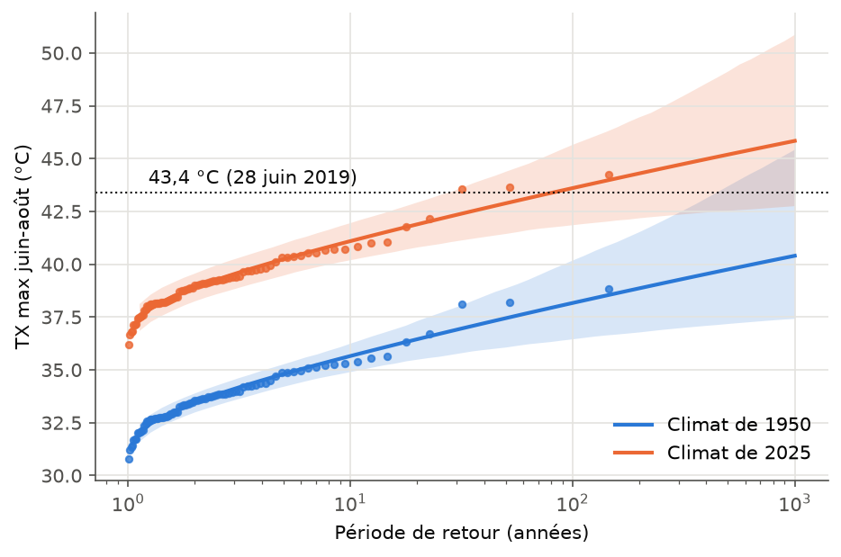

# Canicule de juin 2019 à Salon-de-Provence

J'ai découvert la théorie des valeurs extrêmes en cours de spécialisation Science des données et de la décision. Le sujet m'a beaucoup plu mais je l'ai trouvé assez dur à saisir en restant sur la théorie, donc j'ai voulu l'appliquer sur un vrai jeu de données pour mieux comprendre. J'ai pris le climat parce que je suis aussi en spécialisation énergie-environnement et que c'est un domaine qui m'intéresse.

Le point de départ : le 28 juin 2019, la station Météo-France de Salon-de-Provence a mesuré 43,4 °C, alors que le record d'avant était 39,7 °C (1983). Je voulais savoir à quel point c'est rare, et si ça l'était autant dans le climat des années 1950.

## Ce que fait le projet

Je prends le maximum de température de chaque été (juin-août) depuis 1939, soit 81 étés, et j'ajuste une loi GEV dont le paramètre de position dépend de la température moyenne globale :

```
mu(t) = mu0 + alpha * T_globale(t)
```

sigma et xi restent constants. Le code de la vraisemblance et de l'ajustement est fait à la main avec scipy (`gev.py`), plutôt qu'avec une librairie toute faite. C'était un peu le but pour comprendre. Les intervalles de confiance viennent d'un bootstrap paramétrique.

Résultats (IC à 95 %) :

- période de retour de 43,4 °C dans le climat de 2025 : environ **80 ans** [27 - 11 600]
- dans le climat de 1950 : environ 33 000 ans, mais l'IC va jusqu'à l'infini, donc ce chiffre est surtout là pour l'ordre de grandeur
- les maxima estivaux ont pris **+5,4 °C** entre 1950 et 2025 [4,6 - 6,4]



Les points sont les observations ramenées à chaque climat.

La hausse locale estimée est très forte : alpha ≈ 4,4 °C par degré de réchauffement global. Pour écarter un problème propre à la station, j'ai comparé avec Marignane, qui montre la même tendance.

J'ai aussi regardé l'effet d'inclure ou non 2019 dans l'ajustement (le biais de sélection). Sans 2019, la période de retour actuelle passe à environ 170 ans. Un modèle stationnaire ajusté jusqu'en 2018 aurait donné plus de 200 000 ans. Le détail est dans `results/resultats.json`.

## Lancer

```
pip install -r requirements.txt
python analyse.py        # ou python analyse.py 100 pour aller plus vite
pytest
```

Il faut le lancer depuis la racine du repo. Le script télécharge les données au premier lancement (~20 Mo, Météo-France via data.gouv.fr et GISTEMP pour la température globale). Ensuite il écrit les figures dans `figures/` et les résultats dans `results/`. Avec 1000 tirages de bootstrap, ça prend quelques minutes. Testé seulement sur mon Mac.

## Limites / à faire

- xi est mal estimé (IC entre -0,22 et 0,13), donc la borne supérieure de la loi ne veut pas dire grand chose ici
- la série de la station n'est pas homogénéisée
- une seule station : ce serait intéressant de faire pareil sur d'autres stations, ou d'ajouter de la dépendance spatiale
- calculer les IC par vraisemblance profilée au lieu du bootstrap
- tester une approche par dépassement de seuil (GPD) pour comparer

Références : Coles, *An Introduction to Statistical Modeling of Extreme Values* (2001), et Philip et al. (2020) pour le protocole d'attribution de World Weather Attribution.
